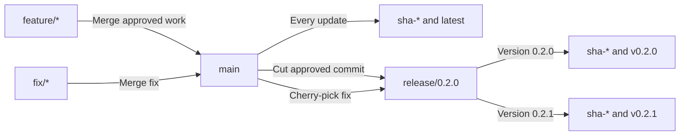

# Expertiza Frontend

This repository contains the React and TypeScript frontend for Expertiza. The application uses
[Vite](https://vite.dev/) for local development and production builds, [Vitest](https://vitest.dev/)
for testing, and Node.js for the development and CI environments.

## Prerequisites

- [Node Version Manager (nvm)](https://github.com/nvm-sh/nvm)
- Docker, if you want to build or run the production container locally
- The Expertiza backend running on `http://localhost:3002` for features that make API requests

The required Node.js version is declared in `.nvmrc` and `package.json`.

## Initial setup

From the repository root, install and select the required Node.js version:

```bash
nvm install
nvm use
```

Install the exact dependency versions recorded in `package-lock.json`:

```bash
npm ci
```

Use `npm ci` instead of `npm install` for a clean, reproducible installation. It is also the
installation command used by the Docker image and GitHub Actions workflow.

## Run the application locally

Start the Vite development server:

```bash
npm run dev
```

Vite prints the local application URL in the terminal. Its default URL is
`http://localhost:5173`.

## Available commands

| Command                         | Purpose                                                                         |
| ------------------------------- | ------------------------------------------------------------------------------- |
| `npm run dev`                   | Start the Vite development server with live reloading.                          |
| `npm run build`                 | Create an optimized production build in `dist/`.                                |
| `npm run preview`               | Serve the existing `dist/` build locally for inspection.                        |
| `npm test`                      | Run Vitest in interactive watch mode.                                           |
| `npm run test:ci`               | Run the test suite once, collect coverage, and create `coverage/`.              |
| `npm run test:coverage:changed` | Create a coverage report using a caller-supplied comparison branch or commit.   |
| `npm run test:coverage:summary` | Generate a machine-readable overall coverage summary.                           |
| `npm run coverage:compare`      | Compare target-branch and pull-request coverage summary files.                  |
| `npm run lint`                  | Check JavaScript and TypeScript files with ESLint.                              |
| `npm run format:check`          | Check whether files follow the configured Prettier style without changing them. |
| `npm run format`                | Rewrite supported files using the configured Prettier style.                    |
| `npm run typecheck`             | Check TypeScript types without generating JavaScript files.                     |

Most validation commands only report problems. `npm run format` is the command in this table that
rewrites source files. The build and coverage commands create generated output in `dist/` and
`coverage/`; both directories are excluded from Git.

## Run the same validation used by CI

Before submitting a pull request, run:

```bash
npm ci
npm run test:ci
npm run lint
npm run format:check
npm run typecheck
npm run build
```

These checks are intentionally separate. A formatting, lint, or type-checking failure does not
necessarily mean that the tests or production build will also fail.

The relevant configuration files are:

- ESLint rules: `eslint.config.mjs`
- Prettier rules: `.prettierrc.yml`
- TypeScript compiler options: `tsconfig.json`
- Vitest configuration: `vitest.config.mts`
- Vite configuration: `vite.config.ts`
- GitHub Actions workflows: `.github/workflows/ci.yml` and
  `.github/workflows/coverage-comment.yml`

## Test coverage

Generate the coverage report with:

```bash
npm run test:ci
```

Open `coverage/index.html` in a browser to view coverage by directory, file, and source line. The
`coverage/` directory is generated locally and is not committed.

GitHub Actions uploads the same directory as an artifact named `frontend-coverage`. The artifact is
available from the workflow run for seven days, including when the test job fails after producing a
report.

### Changed-file coverage

To report coverage only for files changed relative to the latest target branch, update its remote
reference and pass that branch to Vitest. For example, contributors working from a fork can compare
against the upstream repository's `main` branch with:

```bash
git fetch upstream main
npm run test:coverage:changed -- --coverage.changed=upstream/main
```

This command still runs the full test suite, but limits the coverage report to changed files. Its
HTML report is written to `coverage-changed/`. Replace `upstream/main` with the appropriate remote
branch or commit when another target is required. The report is generated even when tests fail, but
the command still returns a failure and does not hide the test result. It does not enforce a coverage
threshold.

For non-draft pull requests, GitHub Actions uploads this HTML report in the
`frontend-changed-coverage` artifact. Open `index.html` after downloading and extracting the
artifact. The artifact is retained for seven days. Pull requests that do not change measurable
source files may report `0/0` coverage.

### Overall coverage comparison

Pull requests also receive an overall coverage comparison. CI checks out the exact target-branch
commit, runs the full coverage suite against both versions, and reports their line, statement,
branch, and function coverage in one automatically updated pull-request comment and in the workflow
summary. The difference is reported in percentage points. A negative value means the pull request
reduced that metric. This comparison is informational and does not enforce a minimum coverage
percentage.

If any metric decreases, the comparison produces a visible warning in the GitHub Check and workflow
summary naming the affected metrics and their percentage-point reductions. The warning does not fail
the comparison by itself and has no tolerance: any decrease is reported. Test failures remain
unchanged and are never hidden by the comparison.

GitHub Actions uploads a `frontend-coverage-comparison` artifact containing a human-readable
`comparison.md` and the machine-readable target-branch and pull-request JSON summaries under
`raw/`. Both coverage artifacts are retained for seven days. A follow-up workflow reads only
`comparison.md` and creates or updates a single coverage comment on the pull request, so later
commits replace the previous report instead of adding duplicate comments.

To run the same comparison locally without switching away from work in progress, create a temporary
Git worktree for the target branch. Run the following commands from the root of the feature-branch
checkout. This example uses `upstream/main`; use `origin/main` or another ref when appropriate.

1. Fetch the target branch and define locations for the two checkouts:

```bash
git fetch upstream main
COVERAGE_REPO_ROOT="$(pwd)"
COVERAGE_BASE_REF="upstream/main"
COVERAGE_BASE_WORKTREE="$(dirname "$COVERAGE_REPO_ROOT")/reimplementation-front-end-coverage-base"
```

2. Create the temporary target-branch checkout and install its locked dependencies:

```bash
git worktree add "$COVERAGE_BASE_WORKTREE" "$COVERAGE_BASE_REF"
cd "$COVERAGE_BASE_WORKTREE"
npm ci
```

3. Generate the target-branch JSON summary:

```bash
npx vitest run \
  --coverage \
  --coverage.reportOnFailure \
  --coverage.reporter=json-summary \
  --coverage.reportsDirectory="$COVERAGE_REPO_ROOT/coverage-base"
```

4. Return to the feature branch and generate its JSON summary:

```bash
cd "$COVERAGE_REPO_ROOT"
npm run test:coverage:summary -- --coverage.reportsDirectory=coverage-head
```

5. Compare the two summaries:

```bash
npm run coverage:compare -- \
  coverage-base/coverage-summary.json \
  coverage-head/coverage-summary.json
```

The output contains the target-branch percentage, feature-branch percentage, and percentage-point
difference for lines, statements, branches, and functions. When finished, remove the temporary
worktree:

```bash
git worktree remove "$COVERAGE_BASE_WORKTREE"
```

The existing test suite currently contains known failures. Coverage reports are still generated,
but the commands and CI job continue to report those test failures.

## Production build

Create an optimized build:

```bash
npm run build
```

The generated files are written to `dist/`. To inspect that build locally:

```bash
npm run preview
```

## Docker

The Dockerfile uses a multi-stage build. Node.js and `npm ci` create the Vite production assets,
and Nginx serves those assets with single-page-application routing support.

Build the image:

```bash
docker build --tag expertiza-frontend:local .
```

Run it on port 8080:

```bash
docker run --detach --rm \
  --name expertiza-frontend-local \
  --publish 8080:80 \
  expertiza-frontend:local
```

Open `http://localhost:8080`, or verify the server from the terminal:

```bash
curl -I http://localhost:8080
```

Stop the container:

```bash
docker stop expertiza-frontend-local
```

If port 8080 is already in use, publish another local port, such as `--publish 8081:80`, and open
`http://localhost:8081` instead.

You can also build and run the service defined in `docker-compose.yml`:

```bash
docker compose up --build
```

### Published container image

The `Publish frontend container image` GitHub Actions workflow builds the existing `Dockerfile` and
publishes the resulting image to GitHub Container Registry after a push to `main`. Versioned releases
are prepared on short-lived `release/<version>` branches, and `package.json` is the source of truth
for the release version.

The published image name is:

```text
ghcr.io/expertiza/reimplementation-front-end
```

#### Images published from `main`

Whenever a commit reaches `main`, including through a merged pull request, the workflow builds and
publishes the frontend image with a `sha-` tag made from the short Git commit SHA (the merge or
squash-merge commit when applicable). A separate serialized job verifies that the commit is still
the head of `main` before promoting that image to `latest`. For example:

```text
ghcr.io/expertiza/reimplementation-front-end:latest
ghcr.io/expertiza/reimplementation-front-end:sha-1a2b3c4
```

This head check prevents a slower, older workflow run from moving `latest` backward. Earlier
commit-SHA tags remain available so that a specific build can be pulled again. Pull requests only
validate that the Docker image builds; they do not publish it.

#### Creating a versioned release

Only a maintainer with permission to prepare a release should perform these steps. Release branches
use the `release/**` naming pattern and remain available for maintenance releases. This lets future
feature development continue on `main` without forcing unreleased features into a patch for an
older version.



Begin with the approved commit on `main`, create the release branch, and push it to the official
repository:

```bash
git switch main
git pull --ff-only origin main
git switch -c release/0.2.0
git push --set-upstream origin release/0.2.0
```

If the official repository is configured as a remote other than `origin`, use that remote name in
the pull and push commands. Prepare the release on a branch based on `release/0.2.0`. Update the
version in both `package.json` and `package-lock.json` without creating a local Git tag, then open a
pull request back into `release/0.2.0`:

```bash
git switch release/0.2.0
git pull --ff-only origin release/0.2.0
git switch -c chore/prepare-0.2.0
npm version 0.2.0 --no-git-tag-version
git add package.json package-lock.json
git commit -m "chore: prepare frontend release 0.2.0"
git push --set-upstream origin chore/prepare-0.2.0
```

When that pull request is merged into `release/0.2.0`, the workflow sees the package-version change,
validates it, and publishes the commit-SHA tag and a version tag derived from `package.json`. Release
branches never move `latest`:

```text
ghcr.io/expertiza/reimplementation-front-end:v0.2.0
```

Stable versions such as `0.2.0` create regular GitHub Releases. Prerelease versions such as
`0.2.0-rc.1` create GitHub prereleases. SemVer build metadata suffixes such as `+build.1` are not
supported because container registries normalize those characters and can produce ambiguous image
tags.

Use a SemVer value without a leading `v` in `package.json`; the workflow adds the `v` when it creates
the image tag, Git tag, and GitHub Release. Examples include:

| `package.json` version              | Result                                         |
| ----------------------------------- | ---------------------------------------------- |
| `1.0.0`                             | Regular release tagged `v1.0.0`                |
| `1.0.0-rc.1`                        | Prerelease tagged `v1.0.0-rc.1`                |
| `v1.0.0`, `1.0`, or `release-1.0.0` | Rejected as invalid                            |
| `1.0.0+build.1`                     | Rejected because build metadata is unsupported |
| `1.0.0-rc.lock`                     | Rejected because it cannot form a Git tag      |

Manually pushing a Git tag does not trigger this workflow. The workflow also checks that the package
version changed, but it does not enforce that the new version is greater than the previous one;
maintainers must choose an increasing, unused version.

The workflow also creates the matching `v0.2.0` Git tag and GitHub Release with generated release
notes. It fails rather than moving a version tag that already points to a different commit.

#### Creating a patch for an existing release

Implement and test the fix on a branch from `main`, then merge it through the normal pull-request
process. This ensures that future releases retain the correction:

```bash
git switch main
git pull --ff-only origin main
git switch -c fix/auth-token
# Make and test the fix.
git add <fixed-files> <test-files>
git commit -m "fix: correct auth token expiration"
git push --set-upstream origin fix/auth-token
```

After that pull request reaches `main`, create a backport branch from the maintained release branch
and cherry-pick the merged fix commit. Update the package version on the backport branch, then open a
pull request into `release/0.2.0`:

```bash
git switch release/0.2.0
git pull --ff-only origin release/0.2.0
git switch -c backport/auth-token-0.2.1
git cherry-pick <merged-fix-commit-sha>
npm version 0.2.1 --no-git-tag-version
git add package.json package-lock.json
git commit -m "chore: prepare frontend release 0.2.1"
git push --set-upstream origin backport/auth-token-0.2.1
```

Merging the backport into `release/0.2.0` publishes `sha-*` and `v0.2.1` without including newer
features from `main` and without changing `latest`. The earlier merge into `main` publishes its own
`sha-*` image and updates `latest`, but it does not create a versioned release.

Pull and run the latest image with:

```bash
docker pull ghcr.io/expertiza/reimplementation-front-end:latest
docker run --detach --rm \
  --name expertiza-frontend \
  --publish 8080:80 \
  ghcr.io/expertiza/reimplementation-front-end:latest
```

Package visibility is managed in the GitHub Container Registry settings. Authentication with an
account that can read the package is required when the image is private.

## GitHub Actions

The frontend workflow runs for pull requests and pushes to `main`. It contains independent jobs
for:

1. Frontend tests with coverage
2. Pull request coverage analysis, combining changed-file coverage and overall comparison
3. ESLint
4. Prettier formatting check
5. TypeScript type check
6. Vite production build
7. Docker image build

Each job uses a clean Ubuntu runner and has its own timeout. The jobs run independently so that a
failure in one check does not prevent the remaining checks from reporting their results.

Container publishing is handled separately by `.github/workflows/publish-image.yml`. It uses the
temporary `GITHUB_TOKEN` supplied by GitHub Actions with `packages: write` permission to publish the
image and `contents: write` permission to create version tags and GitHub Releases. No long-lived
registry password is stored in the repository. Pull requests continue to build the Docker image for
validation but do not publish it.
